# Manual de usuario — Frontend Claude Lovers Gym

Documentación del cliente web de Claude Lovers Gym. Incluye únicamente el
frontend Angular: tecnologías, navegación, permisos y comportamiento visible
para los usuarios.

> **Verificación funcional:** Las capturas son de referencia, no un respaldo de
> datos permanentes: los registros pueden cambiar. Se difuminaron datos
> personales de las cuentas de prueba.

## Contenido

1. [Stack tecnológico](#1-stack-tecnológico)
2. [Navegación y permisos](#2-navegación-y-permisos)
3. [Manual de usuario por vista](#3-manual-de-usuario-por-vista)
    1. [Inicio público](#31-inicio-público)
    2. [Iniciar sesión](#32-iniciar-sesión)
    3. [Panel de operación](#33-panel-de-operación)
    4. [Portal del socio](#34-portal-del-socio)
    5. [Registro y gestión de clientes](#35-registro-y-gestión-de-clientes)
    6. [Planes de membresía](#36-planes-de-membresía)
    7. [Asistencia](#37-asistencia)
    8. [Gestión de membresías](#38-gestión-de-membresías)
    9. [Pagos y estado de cuenta](#39-pagos-y-estado-de-cuenta)
    10. [Reportes](#310-reportes)
    11. [Gestión de usuarios](#311-gestión-de-usuarios)
    12. [Mi perfil](#312-mi-perfil)
4. [Estados y mensajes comunes](#4-estados-y-mensajes-comunes)
5. [Funciones que no constituyen una pantalla operativa](#5-funciones-que-no-constituyen-una-pantalla-operativa)
6. [Flujo recomendado de uso](#6-flujo-recomendado-de-uso)

---

## 1. Stack tecnológico

Versiones exactas instaladas y resueltas en el frontend:

| Área | Tecnología | Versión |
| --- | --- | --- |
| Framework principal | Angular (`core`, `common`, `compiler`, `forms`, `platform-browser`) | 21.2.21 |
| Enrutador | Angular Router | 21.2.21 |
| Cliente HTTP | Angular `HttpClient` (`@angular/common`) | 21.2.21 |
| Interfaz y estilos base | Bootstrap | 5.3.8 |
| Iconografía | Bootstrap Icons | 1.13.1 |
| Estilos propios | CSS3, tokens, utilidades y estilos encapsulados por componente | — |
| Reactividad | RxJS | 7.8.2 |
| Lenguaje | TypeScript | 5.9.3 |
| CLI y compilación Angular | Angular CLI / Angular Build | 21.2.21 |
| Gestor de paquetes | npm | 11.6.0 |

La aplicación utiliza componentes standalone, Angular Signals, formularios
reactivos y template-driven en módulos puntuales, y carga diferida de rutas.
Bootstrap y Bootstrap Icons se incorporan desde `angular.json`; los estilos
del proyecto están bajo `src/styles/` y junto a cada componente.

La URL base de API se configura en `src/environments/environment.ts`. En el
entorno revisado apunta a `http://localhost:8080` y `useMockAuth` está en
`false`: el inicio de sesión usa el backend. Los botones de perfiles de prueba
de la pantalla de login únicamente rellenan el formulario; no habilitan un
modo de autenticación simulado.

## 2. Navegación y permisos

Los nombres de rol `RECEPCION` y `RECEPCIONISTA` se tratan como equivalentes;
`SOCIO` y `CLIENTE` también son equivalentes. Las rutas privadas requieren
sesión; además de ocultar enlaces del menú según el rol, Angular protege las
rutas con guards.

| Vista | Ruta | Acceso |
| --- | --- | --- |
| Inicio público | `/` | Cualquier visitante |
| Iniciar sesión | `/login` | Visitante sin sesión |
| Panel de operación | `/dashboard` | ADMIN, RECEPCIÓN, ENTRENADOR; contenido y navegación dependen del rol |
| Portal del socio | `/dashboard` o `/dashboard/portal-socio` | SOCIO / CLIENTE |
| Gestión de miembros | `/dashboard/socios` | ADMIN, RECEPCIÓN |
| Planes de membresía | `/dashboard/planes` | ADMIN, RECEPCIÓN |
| Registro de asistencia | `/dashboard/asistencia` | ADMIN, RECEPCIÓN, ENTRENADOR |
| Gestión de membresías | `/dashboard/membresias` | ADMIN, RECEPCIÓN |
| Pagos y estado de cuenta | `/dashboard/pagos` | ADMIN, RECEPCIÓN |
| Reportes | `/dashboard/reportes` | ADMIN y RECEPCIÓN; las pestañas dependen del rol |
| Gestión de usuarios | `/dashboard/usuarios` | ADMIN |
| Mi perfil | `/dashboard/perfil` | Cualquier usuario autenticado |

Una URL inexistente vuelve a `/`. Al acceder directamente, una sesión activa
en `/login` se redirige al panel o portal que corresponde. La pantalla de login
es para las cuentas que ya entrega el gimnasio; no hay una ruta pública de
registro. La sección de planes del inicio consume la API y puede usar
contenido de presentación de respaldo si no hay resultados.

## 3. Manual de usuario por vista

### 3.1 Inicio público

**Ruta:** `/` · **Acceso:** público.

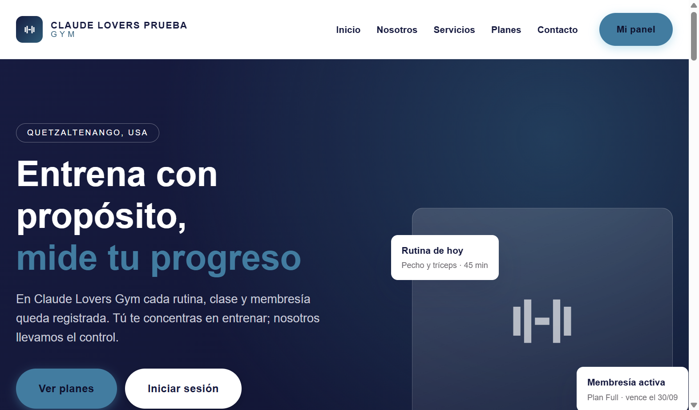

Presenta el gimnasio, servicios, planes, horarios de clases y datos de
contacto. **Ver planes** lleva a la sección de planes; **Inscribirme** en una
tarjeta de plan abre `/login`, al igual que **Iniciar sesión**. El horario
público es informativo y muestra clase, días, horario y entrenador. No hay
formularios de operación en esta vista. La captura muestra la página pública
cargada durante una sesión autenticada. **Observación de acceso:** la ruta no
exige sesión, pero durante la verificación sin autenticar la consulta de planes
devolvió HTTP 401 y la aplicación terminó en `/login`; por ello, el contenido
público solo se pudo verificar con una sesión activa.

### 3.2 Iniciar sesión

**Ruta:** `/login` · **Acceso:** solo visitante; una sesión activa redirige al
panel correspondiente.

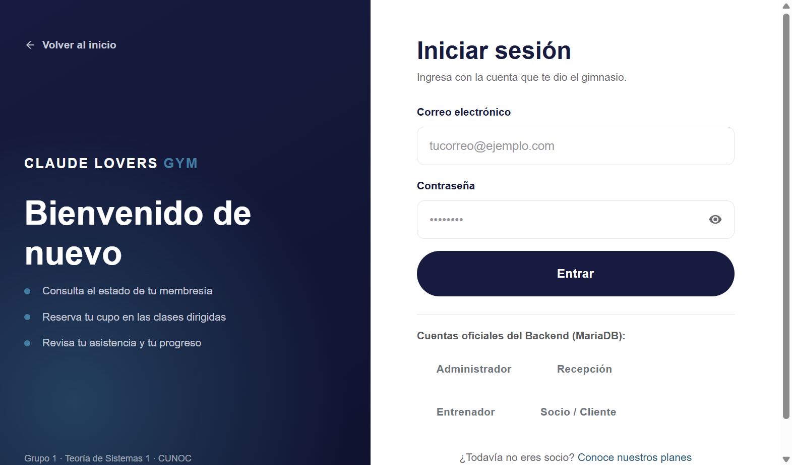

Formulario:

| Campo | Obligatorio | Formato / validación |
| --- | --- | --- |
| Correo electrónico | Sí | Debe tener formato de correo |
| Contraseña | Sí | Mínimo 6 caracteres |

**Entrar** envía las credenciales; mientras espera, cambia a **Verificando…**
y el formulario queda deshabilitado. El icono de ojo alterna la visibilidad de
la contraseña. Al tocar campos inválidos aparecen mensajes de campo como
“El correo es obligatorio”, “Escribe un correo válido” o “Debe tener al menos
6 caracteres”. Si la autenticación falla, se muestra el error recibido del
servidor (o un mensaje de credenciales incorrectas). Los botones por rol
rellenan las credenciales de prueba, pero se requiere que el backend las
acepte.

### 3.3 Panel de operación

**Ruta:** `/dashboard` · **Acceso:** ADMIN, RECEPCIÓN y ENTRENADOR.

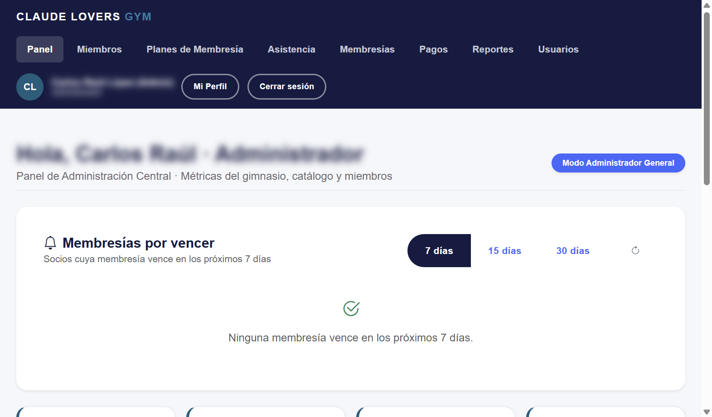

El administrador y recepción ven un saludo, indicadores del gimnasio y
membresías próximas a vencer. El selector permite consultar rangos de 7, 15 o
30 días. Los indicadores incluyen miembros totales, activos y morosos, y
planes en catálogo. Desde las tarjetas se accede a módulos operativos.

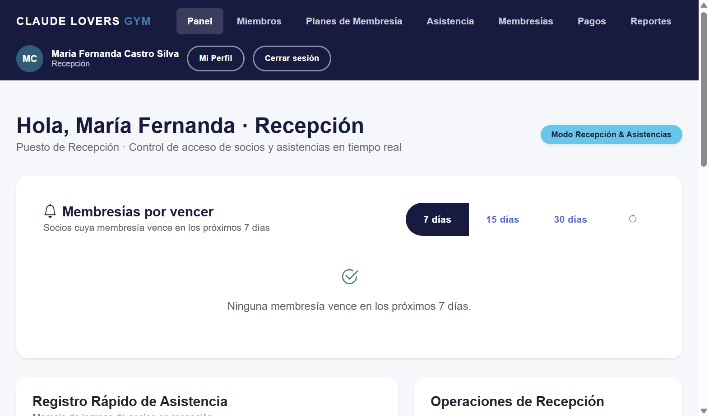

Recepción dispone además del registro rápido de entrada y salida. El registro
requiere seleccionar un socio; se advierte si está moroso o inactivo. Los
resultados y errores de asistencia se informan en la propia vista o mediante
notificaciones.

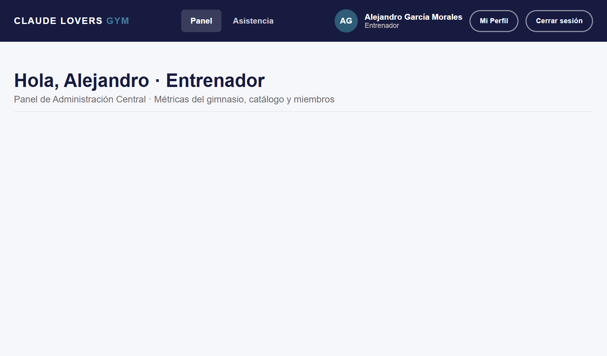

El entrenador tiene un panel restringido y acceso a asistencia; no ve la
navegación administrativa. Las consultas de métricas y vencimientos pueden
mostrar carga, lista vacía o aviso según la respuesta de la API.

### 3.4 Portal del socio

**Ruta:** `/dashboard` (para rol SOCIO / CLIENTE) o
`/dashboard/portal-socio` · **Acceso:** SOCIO / CLIENTE.

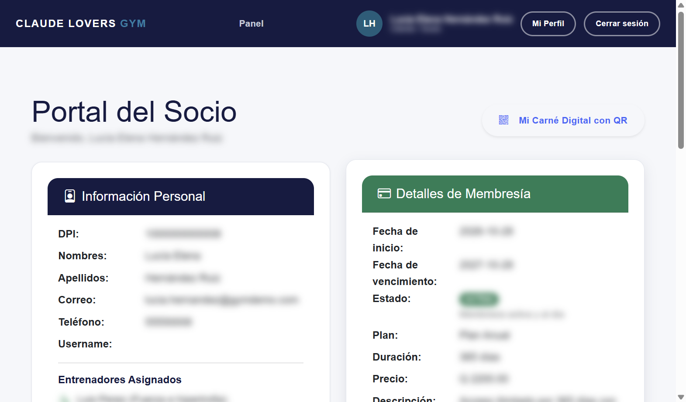

Área personal con información de cuenta, membresía, vencimiento, plan,
entrenadores y clases asignadas; también muestra mediciones y asistencias
cuando el servicio entrega esos datos. **Mi Carné Digital con QR** abre el
carné:

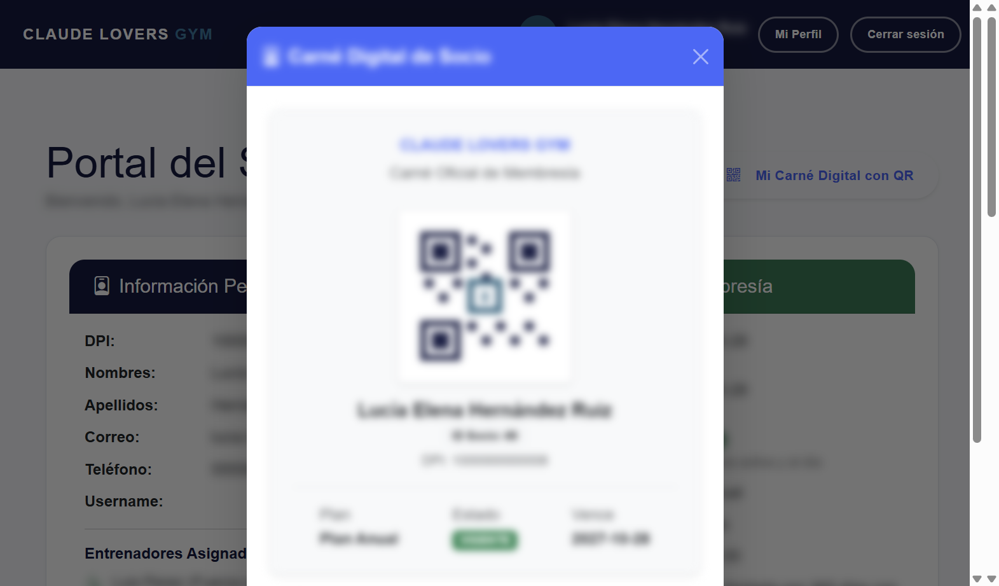

El historial de pagos se presenta como tabla con número, fecha, plan, método,
monto, vigencia, responsable y comprobante. No incluye un formulario para
reservar clases. Los datos se cargan al entrar con la cuenta del socio; si la
consulta falla, aparece un mensaje de error con **Reintentar**. Cuando hay
membresía próxima a vencer o vencida se presenta un aviso con el número de días
y la recomendación de renovación.

Las capturas se tomaron después de cargar el portal con una sesión de socio;
los datos personales están difuminados.

### 3.5 Registro y gestión de clientes

**Ruta de operación:** `/dashboard/socios` · **Acceso:** ADMIN y RECEPCIÓN.

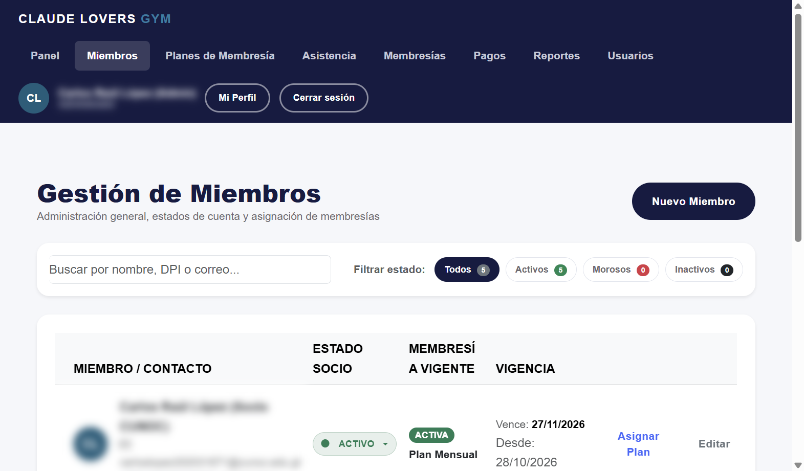

La pantalla permite buscar por nombre, apellido, correo o DPI y filtrar por
estado (**Todos**, **Activos**, **Morosos**, **Inactivos**). La tabla resume
miembro/contacto, estado del socio, membresía vigente, vigencia y acciones.
Desde cada fila se puede cambiar el estado, asignar un plan, editar o eliminar
según el rol. El borrado permanente es exclusivo de ADMIN.

**Nuevo Miembro** abre el formulario de alta:

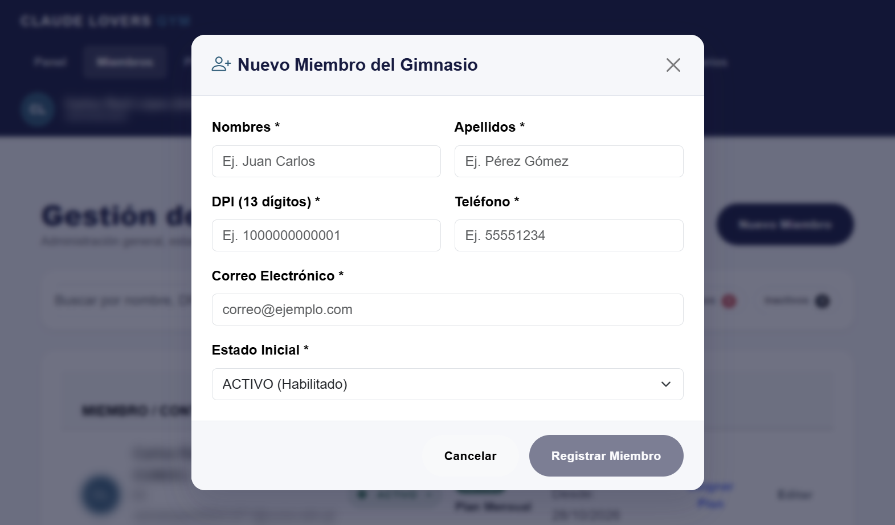

| Campo | Obligatorio | Formato / validación |
| --- | --- | --- |
| Nombres | Sí | Mínimo 2 caracteres |
| Apellidos | Sí | Mínimo 2 caracteres |
| DPI | Sí | Exactamente 13 dígitos numéricos |
| Teléfono | Sí | 7–15 caracteres; acepta números, `+`, espacios y `-` |
| Correo electrónico | Sí | Formato de correo |
| Estado inicial | Sí | Lista de estados; valor inicial ACTIVO |

**Registrar Miembro** guarda el alta; **Cancelar** cierra el diálogo. En
edición se usan los mismos campos. Los formularios inválidos se marcan para
mostrar la validación y los fallos de guardado aparecen en el diálogo o como
notificación; al completar una operación se notifica el resultado. La pantalla
muestra también las acciones de asignación de plan y baja.

**Aclaración de alcance:** no existe actualmente una página pública ni ruta
`/registro`. La página anterior es el alta administrativa de un miembro. El
componente reutilizable de registro propio (`SocioFormComponent` en modo
`self`) contiene campos de identidad, correo, teléfono, nombre de usuario,
contraseña y confirmación, pero no está conectado a una ruta o botón público.
Por ello no se presenta como una pantalla disponible para el usuario final.

### 3.6 Planes de membresía

**Ruta:** `/dashboard/planes` · **Acceso:** ADMIN y RECEPCIÓN.

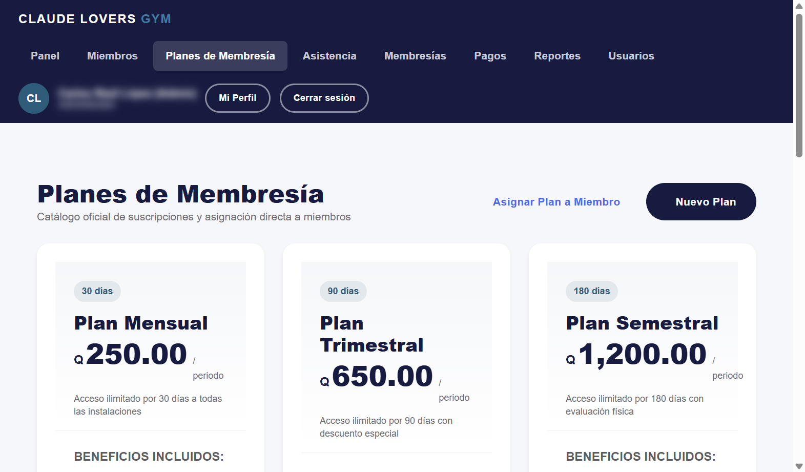

El catálogo presenta las tarjetas/listado de planes y permite asignarlos a un
miembro. ADMIN puede crear, editar y eliminar planes; RECEPCIÓN puede consultar
y asignar.

Formulario de plan:

| Campo | Obligatorio | Formato / validación |
| --- | --- | --- |
| Nombre del plan | Sí | Mínimo 3 caracteres |
| Duración | Sí | Número de días, mínimo 1 |
| Precio | Sí | Número decimal en quetzales, mínimo Q 0.01 |
| Descripción | Sí | Texto |
| Beneficios | No | Texto separado por comas |

En **Asignar plan** se seleccionan miembro y plan y se introduce la fecha de
inicio (`AAAA-MM-DD`); la fecha de vencimiento se calcula y se muestra como
solo lectura. Los cambios se guardan desde el diálogo. Las validaciones o los
errores del servicio se comunican en el formulario/notificación.

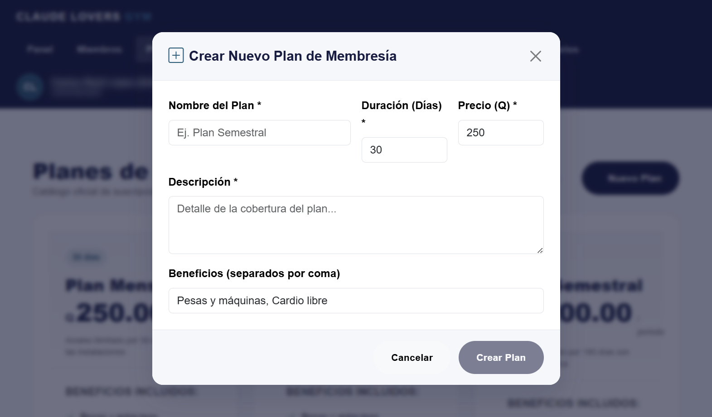
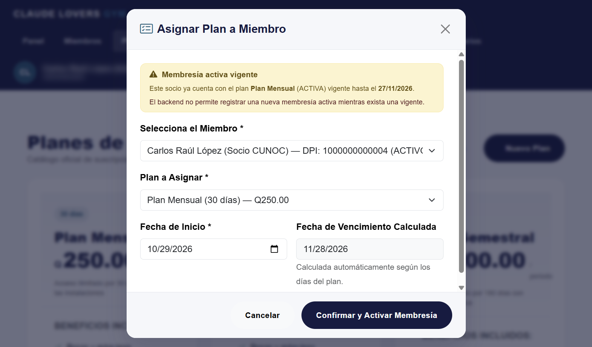

### 3.7 Asistencia

**Ruta:** `/dashboard/asistencia` · **Acceso:** ADMIN, RECEPCIÓN y ENTRENADOR.

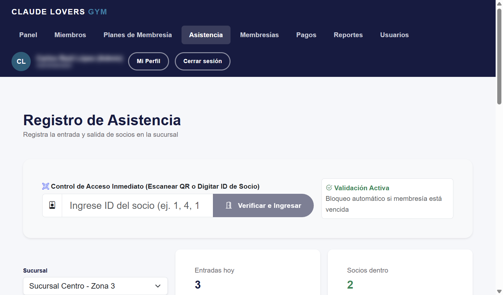

Permite filtrar socios por nombre, apellido o ID, elegir sucursal y registrar
una entrada mediante selección en la lista o ingreso rápido de un ID numérico.
La tabla de socios incluye socio, membresía, estado y acción (entrada/salida).
La tabla de asistencias del día muestra socio, hora de entrada, hora de salida
y sucursal.

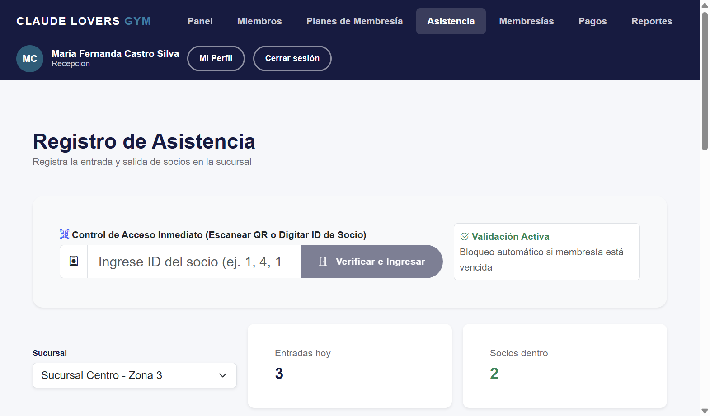
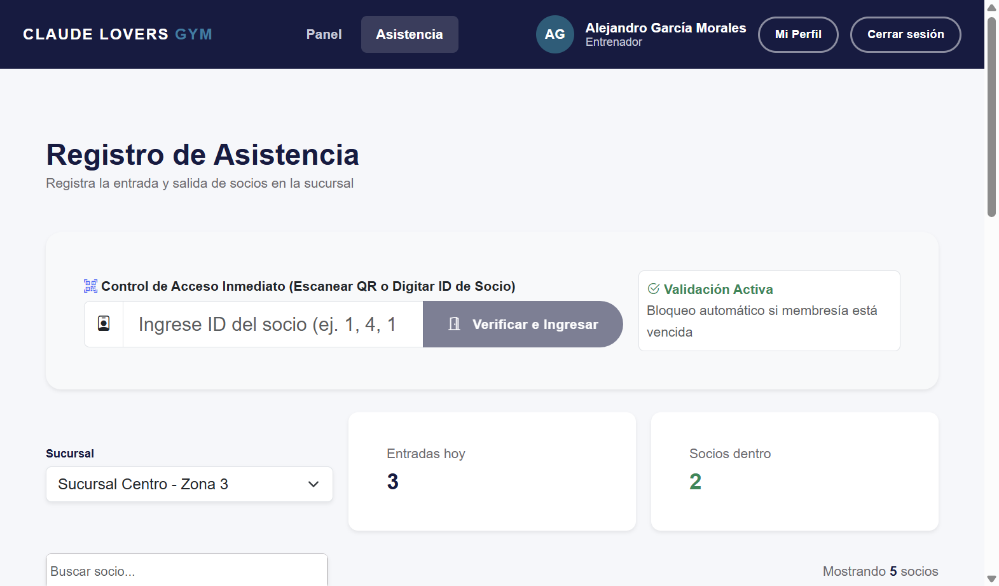

Al procesar un acceso se deshabilita temporalmente la acción. El éxito muestra
una confirmación con socio/hora; una membresía no activa o vencida muestra un
aviso de acceso bloqueado con el motivo del servicio. Durante la consulta se
muestra carga; un error de carga puede dejar las listas vacías y mostrar un
aviso.

### 3.8 Gestión de membresías

**Ruta:** `/dashboard/membresias` · **Acceso:** ADMIN y RECEPCIÓN.

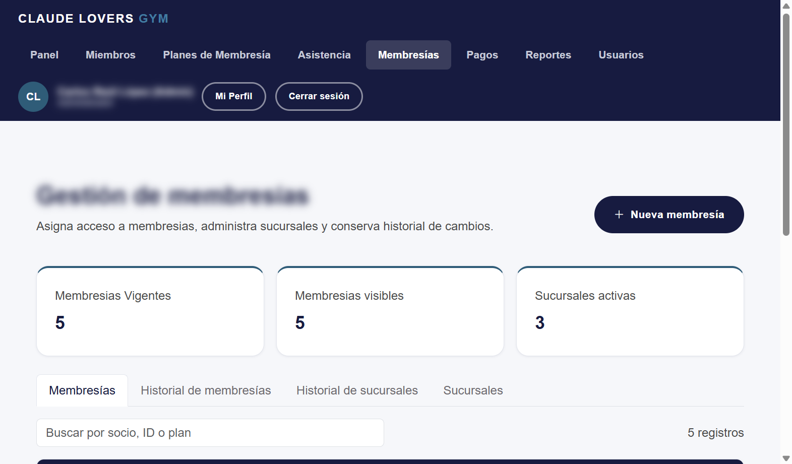

Incluye indicadores de membresías vigentes/visibles y sucursales activas, un
buscador por socio, ID o plan, y las pestañas **Membresías**, **Historial de
membresías**, **Historial de sucursales** y **Sucursales**. La tabla principal
muestra socio/ID, plan, vigencia, estado y acción. Los historiales registran
fecha, acción, usuario que ejecutó, detalle y valores anterior/nuevo. La vista
de sucursales incluye ID, nombre, dirección, estado y acción.

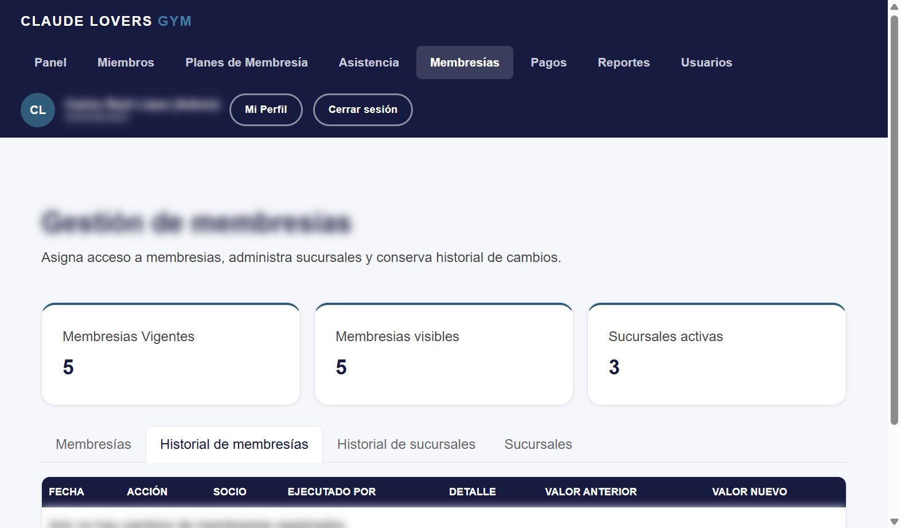
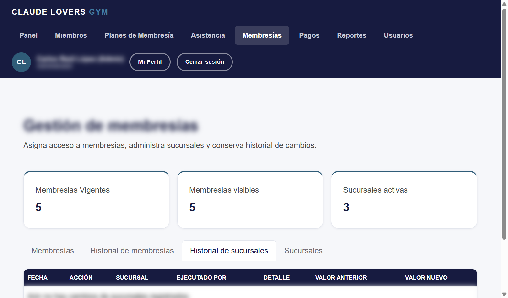
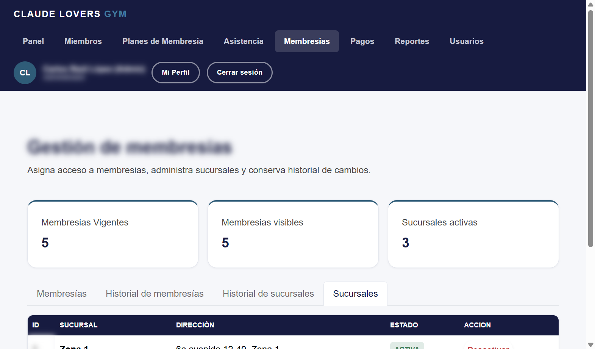

Al crear una membresía se requieren socio, plan y fecha de inicio. El plan
determina el precio y la fecha de fin se calcula automáticamente; ambos son
solo lectura. Se puede seleccionar estado (ACTIVA, CONGELADA o CANCELADA; la
opción VENCIDA se deriva y no se ofrece en el selector). Para guardar una
cancelación se exige motivo de al menos 3 caracteres. Al guardar se muestra
“Cambios guardados y auditados”; los errores de validación o servicio se
muestran en el diálogo. La activación/desactivación de sucursales es exclusiva
de ADMIN.

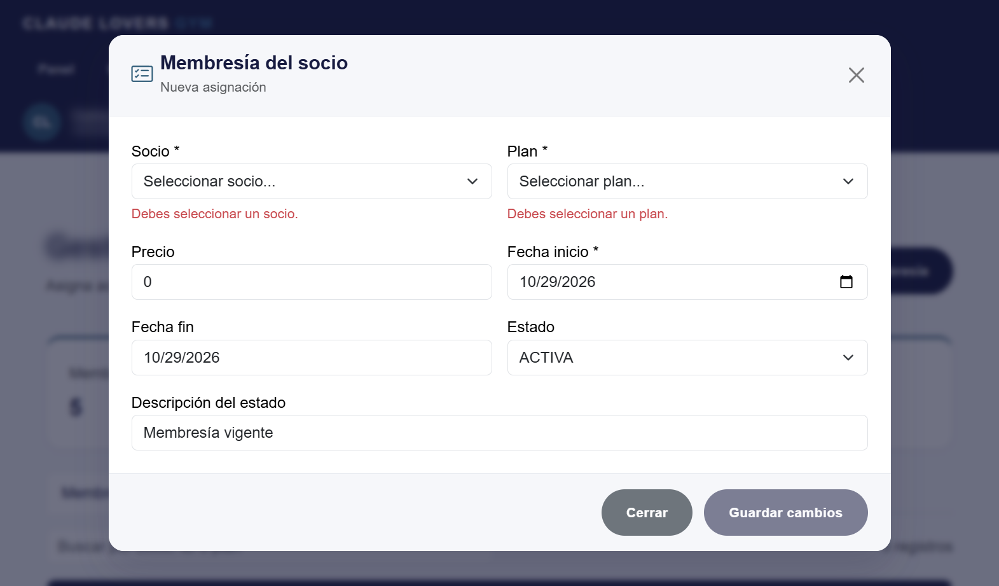

### 3.9 Pagos y estado de cuenta

**Ruta:** `/dashboard/pagos` · **Acceso:** ADMIN y RECEPCIÓN.

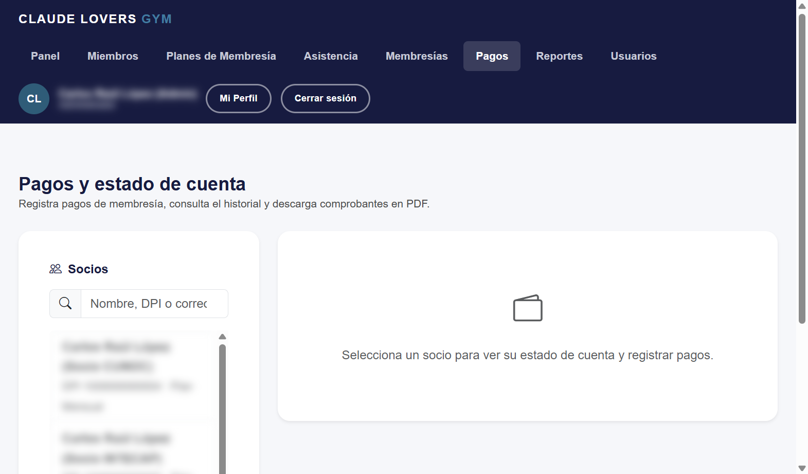

Se busca al socio por nombre, DPI o correo y se consultan sus membresías
pagables (plan, estado, inicio, vencimiento y precio). Selecciona un socio y
usa **Registrar pago** o **Cobrar** para abrir el formulario:

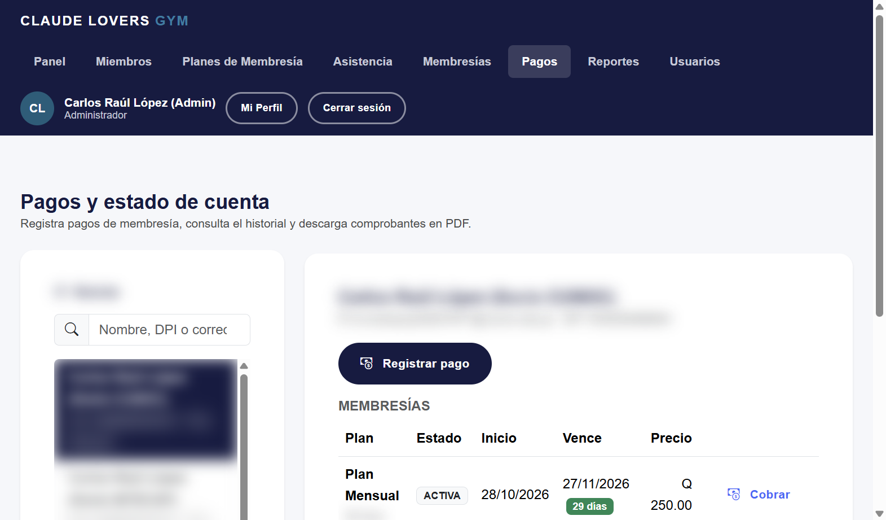
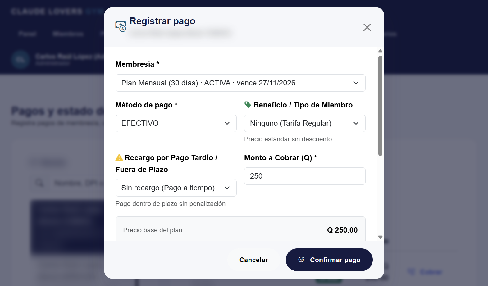

El formulario de cobro incluye:

| Campo | Obligatorio | Formato / validación |
| --- | --- | --- |
| Membresía | Sí | Selección de una membresía |
| Método de pago | Sí | Selección del catálogo |
| Beneficio | Sí | Selección; valor inicial REGULAR |
| Recargo | Sí | Selección; valor inicial NINGUNO |
| Monto a cobrar | Sí | Número decimal, mínimo Q 0.01 |
| Referencia | No | Texto de hasta 100 caracteres |
| Nota adicional | No | Texto de hasta 255 caracteres |

El importe sugerido calcula el precio menos el beneficio más el recargo por
mora. Para pagos en efectivo se valida el mínimo correspondiente; la pantalla
puede mostrar el aviso de monto insuficiente. El historial lista número, fecha,
plan, método, monto, vigencia, responsable y comprobante. Los estados de carga
de membresías y los errores se muestran en el módulo; el registro correcto
confirma la operación y refresca el historial.

### 3.10 Reportes

**Ruta:** `/dashboard/reportes` · **Acceso:** ADMIN y RECEPCIÓN.

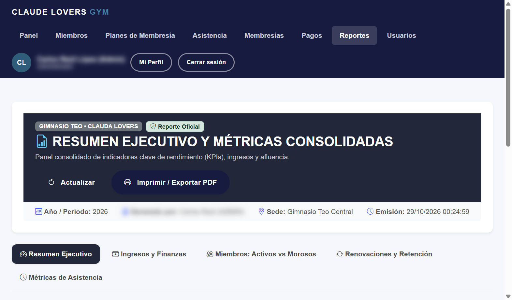

ADMIN ve cinco pestañas: **Resumen Ejecutivo**, **Ingresos y Finanzas**,
**Miembros**, **Renovaciones y Retención** y **Métricas de Asistencia**.
RECEPCIÓN ve Resumen, Miembros y Asistencias; las pestañas de ingresos y
renovaciones están reservadas a ADMIN. El resumen consolida indicadores; los
reportes presentan cifras y tablas de ingresos por mes/método, estado de
miembros y vencimientos, retención/renovaciones y afluencia/horas pico.

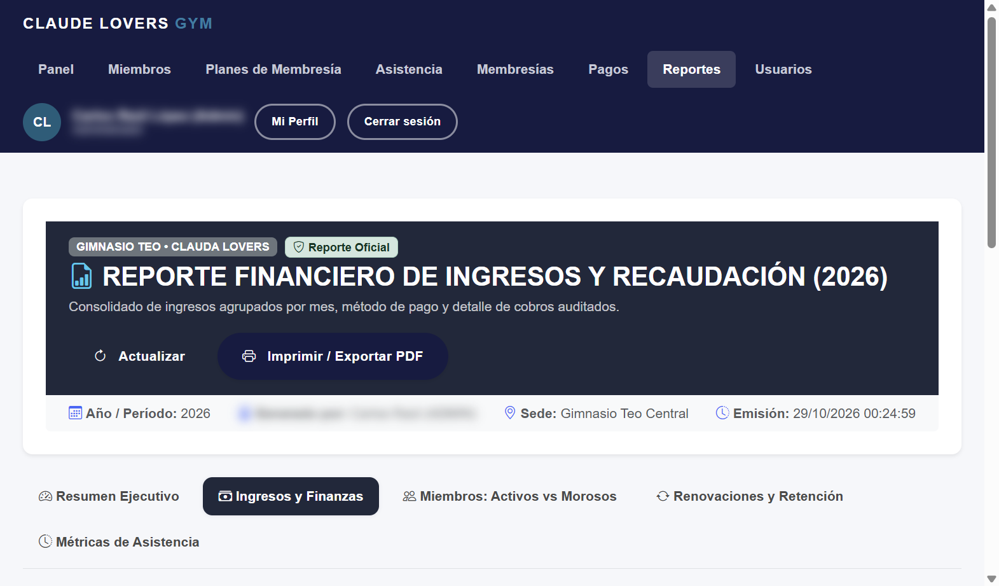
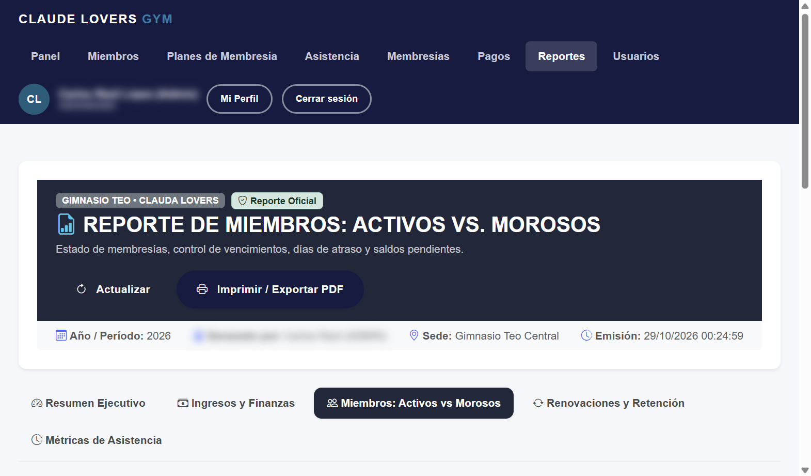
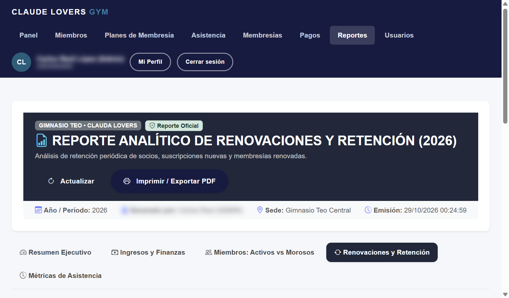
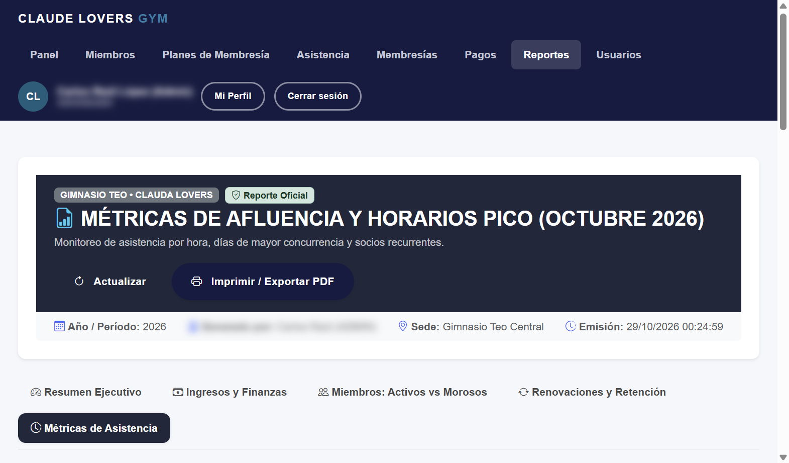

Filtros visibles según pestaña:

- Ingresos y renovaciones: año (opciones 2024, 2025 y 2026).
- Miembros: estado, sucursal y búsqueda de persona.
- Asistencias: mes y año.

Las tablas varían con el reporte: por ejemplo, el reporte de miembros incluye
socio, plan actual, fecha de vencimiento, días restantes y acción; el de
ingresos incluye mes, año, cobros y monto total. Desde algunos resultados se
puede ir al cobro/renovación del socio. **Actualizar** vuelve a consultar la
pestaña y **Imprimir / Exportar PDF** abre el diálogo de impresión del
navegador. La vista indica carga mientras consulta el servicio y muestra un
error con **Reintentar** si el reporte no se puede cargar.

### 3.11 Gestión de usuarios

**Ruta:** `/dashboard/usuarios` · **Acceso:** ADMIN exclusivamente.

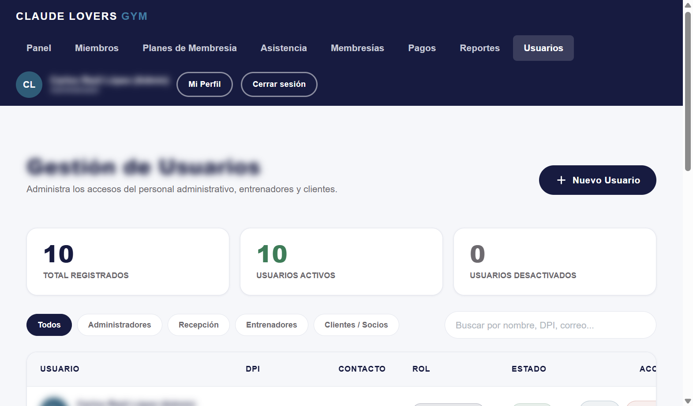

Permite filtrar por rol y buscar por nombre, DPI, correo o teléfono. La tabla
muestra usuario, DPI, contacto, rol, estado y acciones. Desde sus diálogos se
puede crear, editar o desactivar/reactivar una cuenta.

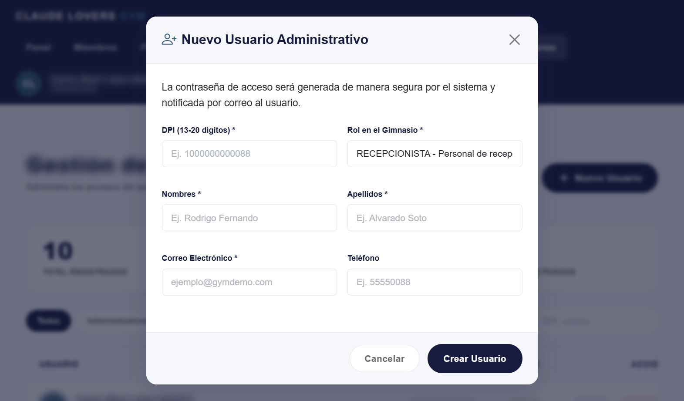

Al crear se solicitan DPI (13–20 dígitos), nombres y apellidos (mínimo 2
caracteres), correo válido y rol; teléfono es opcional y acepta 8–15
caracteres numéricos con `+`, espacios o `-`. Al editar se pueden cambiar esos
datos, rol y estado; la contraseña es opcional y, si se cambia, debe tener al
menos 6 caracteres. La pantalla tiene estado de carga y error de lista; las
operaciones informan errores en el diálogo/notificación y pueden mostrar una
credencial temporal retornada por el backend.

### 3.12 Mi perfil

**Ruta:** `/dashboard/perfil` · **Acceso:** cualquier usuario autenticado.

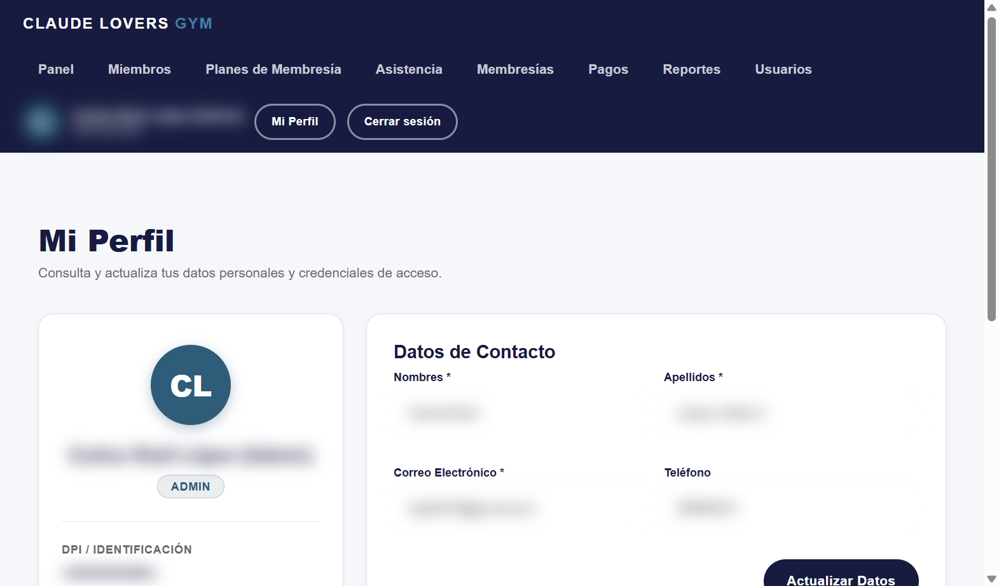

Se divide en datos de contacto y seguridad:

- **Datos de contacto:** nombres y apellidos obligatorios (mínimo 2
  caracteres), correo obligatorio y válido, teléfono opcional (8–15
  caracteres con números, `+`, espacio o `-`). **Guardar cambios** se desactiva
  durante el guardado o mientras los datos sean inválidos.
- **Seguridad y contraseña:** contraseña actual, nueva contraseña (mínimo 6
  caracteres) y confirmación, los tres obligatorios. La contraseña nueva y su
  confirmación deben coincidir.

Los formularios muestran errores de validación al interactuar; guardados
correctos y fallidos se comunican con notificación. Durante el envío se
deshabilitan las acciones correspondientes.

## 4. Estados y mensajes comunes

- **Carga:** se muestran indicadores o texto de espera (por ejemplo,
  “Verificando…” en login y “Cargando…” en consultas). Durante operaciones de
  guardado o cobro se deshabilitan botones para evitar envíos repetidos.
- **Validación:** los formularios reactivos marcan controles como tocados al
  intentar guardar con datos inválidos. Las reglas específicas aparecen en
  cada vista de este manual.
- **Errores de API:** pueden aparecer en un modal, en un bloque de error de la
  vista o como toast. Si la API está apagada, un mensaje habitual es “No se
  pudo conectar con el servidor. Verifica tu conexión.” Algunas consultas
  muestran lista vacía o contenido de respaldo; eso no confirma que la
  operación se haya guardado en el backend. Durante esta revisión, las vistas
  protegidas se consultaron con autenticación y datos devueltos por la API.
- **Éxito:** las operaciones de alta, actualización, pago o marcaje muestran
  una confirmación o toast y actualizan la vista/lista afectada.
- **Sesión:** la sesión se conserva en `localStorage` bajo `gym.sesion` y tiene
  una duración de ocho horas según el frontend. Las rutas aplican guards por
  sesión y rol.

## 5. Funciones que no constituyen una pantalla operativa

- **Registro público de clientes:** no hay ruta ni página pública implementada.
  El alta disponible actualmente es el diálogo **Nuevo Miembro** en
  `/dashboard/socios`.
- **Clases:** se muestra un horario informativo en el inicio y las clases
  asignadas al socio en el portal; el frontend no expone en este alcance una
  pantalla para administrar clases o reservar cupos.
- **Rutas y diálogos:** la página de inicio y los formularios/módulos
  descritos son las vistas accesibles desde las rutas registradas en
  `app.routes.ts`; los diálogos de alta/edición son estados de esas vistas, no
  rutas independientes.

## 6. Flujo recomendado de uso

Este recorrido representa una operación habitual del gimnasio. Las capturas
documentan los formularios y estados de consulta.

1. **Entrar al sistema:** ADMIN o RECEPCIÓN inicia sesión en `/login` con una
   cuenta habilitada. La navegación y los módulos disponibles cambian según el
   rol.
2. **Registrar al cliente:** desde `/dashboard/socios`, elegir **Nuevo
   Miembro**, completar los datos obligatorios y guardar. El nuevo registro
   aparece en la búsqueda/listado de miembros.
3. **Asignar un plan:** desde `/dashboard/planes`, elegir **Asignar plan** y
   seleccionar socio, plan y fecha de inicio. También se puede administrar la
   asignación desde `/dashboard/membresias`; el sistema calcula la fecha final.
4. **Registrar el cobro:** abrir `/dashboard/pagos`, buscar y seleccionar al
   socio, escoger la membresía pagable, el método de pago y los valores
   aplicables de beneficio/recargo. Revisar el total calculado y confirmar el
   pago. El módulo presenta la confirmación y permite descargar el comprobante
   PDF.
5. **Registrar asistencia:** en `/dashboard/asistencia` buscar o seleccionar
   al socio y registrar entrada o salida. ADMIN, RECEPCIÓN y ENTRENADOR pueden
   utilizar esta vista; el resultado informa si el acceso fue aceptado o
   rechazado.
6. **Consultar resultados:** ADMIN revisa las pestañas de `/dashboard/reportes`
   y puede imprimir o exportar el informe a PDF. RECEPCIÓN dispone de resumen,
   miembros y asistencias, pero no de reportes de ingresos ni renovaciones.
7. **Consultar como socio:** cerrar la sesión administrativa e iniciar sesión
   con la cuenta del socio. `/dashboard` abre su portal, donde puede revisar la
   membresía, pagos y asistencias, y mostrar su carné QR. El alta de la cuenta
   y la entrega de credenciales dependen del proceso administrativo del
   gimnasio; no hay autorregistro público.
